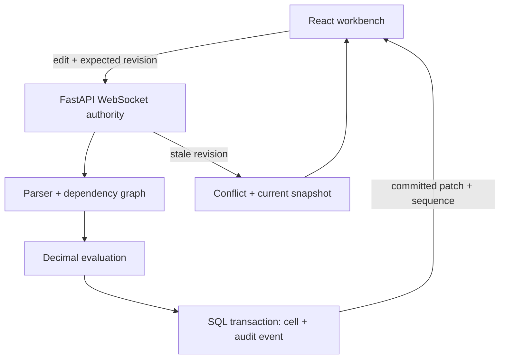

# Ledger

**Live demo:** https://saketmoduga10.github.io/Ledger/

### Every number has a story.

A collaborative financial modeling workbench with a custom formula interpreter, incremental recalculation, and a server-authoritative WebSocket protocol. React · FastAPI · PostgreSQL · Decimal arithmetic · optional Auth0.

Ledger makes the engineering inspectable: select a number to see its formula, direct dependencies, downstream cells, and durable edit history. Change an assumption and watch measured recalculation and acknowledgement times. No simulated collaborators or invented telemetry.

## Try it locally

Requires Docker with Compose:

```sh
git clone <your-repository-url>
cd ledger
cp .env.example .env
docker compose up --build
```

Open **http://localhost:8080** in two windows. The default shared demo requires no login and persists data in PostgreSQL. All users edit one seeded six-month SaaS model. `docker compose down` preserves the model; `docker compose down -v` deletes local model data.

Without Docker (Python 3.12+, Node 22+):

```sh
python3 -m venv .venv
source .venv/bin/activate
pip install -r backend/requirements.txt websockets
cd frontend
npm ci
cd ..
npm run dev
```

Open **http://localhost:4173**. This fallback uses SQLite, not PostgreSQL. If your shell cannot find the activated interpreter, use `LEDGER_PYTHON="$(which python3)" npm run dev`.

## A 90-second walkthrough

1. Select **C3**, change monthly growth from `0.08` to `0.12`, and press Enter or Apply. See downstream revenue, profit, and cash change. Values commit only after acknowledgement.
2. Select **G20** to inspect the cash formula, then follow the dependency buttons. Referenced cells are highlighted in the grid.
3. Open another window and edit the same model. Commits appear in both views. Stale writes are rejected and refreshed rather than silently overwriting newer data.
4. Try `=G20` in **C3**. The server rejects the cycle without changing the model.
5. Capture a baseline in **Scenario studio**, return to the model, change assumptions, then compare. Baselines are browser-session snapshots, not shared persisted scenarios.
6. Select a cell to inspect its edit history; export evaluated values to CSV.

## Architecture



**Formula engine.** A recursive-descent / precedence-climbing parser creates an AST; it never calls `eval`. Supported syntax: decimal numbers, cell references, rectangular ranges, parentheses, unary signs, `+ - * / ^`, and `SUM`, `AVG`, `MIN`, `MAX`, `ABS`, `ROUND`, `IF`. `IF` uses a numeric condition (zero is false); comparison operators, Excel compatibility, string cells, and cross-sheet references are outside this version. `ROUND` uses Decimal's default half-even rounding. See [engine details](docs/engineering.md).

**Incremental calculation.** Forward dependencies support cycle checks; reverse dependencies identify the affected subgraph. Kahn ordering recalculates each affected cell after its affected parents. Unrelated formulas are not evaluated. Financial calculations use Python Decimal and serialize as strings; the frontend converts to numbers only for display.

**Conflict policy.** Each cell has a revision. The authority serializes edits, validates the expected revision, evaluates the new state, commits cell state and history together, then broadcasts. First accepted revision wins. A stale client gets a complete snapshot and an explicit conflict notice. No CRDT, silent merge, or client timestamp ordering is claimed.

**Recovery.** Reconnect sends a full snapshot. The UI does not automatically replay unconfirmed edits, because their transaction may already have committed before disconnection. Audit records explain accepted changes. Slow WebSocket sends have a timeout.

## Recorded run (October 20, 2026)

| Check | Result |
| --- | --- |
| Python tests | 9 passed |
| React production build | Passed |
| 6,000-cell sparse model, incremental median | 0.072 ms |
| Same model, full AST evaluation median | 5.681 ms |
| 10 clients, disjoint inputs | 5,000 accepted edits; 0 divergent clients |
| Disjoint workload median acknowledgement | 38.87 ms |
| Disjoint workload p95 acknowledgement | 58.3 ms |

These are local SQLite and in-process engine results. See the workload definitions below; they replace, rather than validate, the original resume figures.

## Tests and benchmarks

```sh
PYTHONPATH=backend DATABASE_URL=sqlite:///./test.db python -m pytest backend/tests -q
python benchmarks/recalculate.py
pip install websockets
python benchmarks/run_local.py
python benchmarks/run_local.py disjoint
cd frontend && npm run build
```

Recorded results are in [`benchmarks/`](benchmarks/). These are environment-specific localhost measurements, not production service guarantees. The formula workload is 6,000 cells across 200 independent chains; a root edit affects 30 cells. The full-evaluation baseline reuses parsed ASTs. This intentionally sparse workload demonstrates dependency pruning and does not represent every financial model.

The contention collaboration workload uses ten real WebSocket clients and 5,000 overlapping **attempts** against one cell. It reports accepted edits, rejected conflicts, acknowledgement latency, and final state divergence separately. Conflict responses are included in acknowledgement timing. It does **not** establish support for 5,000 concurrent users. A separate `disjoint` workload assigns one input cell to each client and checks convergence across 5,000 accepted edits.

Validated here: nine Python tests, React production build, formula benchmark, and real WebSocket benchmark against SQLite. Docker/PostgreSQL, Auth0 tenant login, and browser visual/end-to-end checks have **not** been verified in the creation environment. CI runs tests and a frontend build; add a PostgreSQL integration job before treating that deployment as validated.

## Auth0 setup

1. Create an Auth0 single-page application and API with an audience identifier.
2. Add `http://localhost:8080` to allowed callback URLs, logout URLs, and web origins.
3. Set `DEMO_MODE=false`, `AUTH0_DOMAIN`, `AUTH0_CLIENT_ID`, and `AUTH0_AUDIENCE` in `.env`; rebuild with `docker compose up --build`.
4. For direct Vite development, put `VITE_AUTH0_DOMAIN`, `VITE_AUTH0_CLIENT_ID`, `VITE_AUTH0_AUDIENCE` in `frontend/.env.local`, and set corresponding backend variables (`DEMO_MODE=false`, `AUTH0_DOMAIN`, `AUTH0_AUDIENCE`) in your launch environment.

The client sends its access token as the first WebSocket frame, not in the URL. The server checks the RS256 signature against JWKS plus issuer, audience, and expiration. This is authentication for a **single shared workspace**, not tenant isolation or per-workbook authorization. Login is not enough for a public multi-tenant service.

## Deliberate limits

- Run **one API worker / one API instance**. Its lock, graph, and connections are in process. Multiple instances need workbook routing or a shared sequencer; adding Redis pub/sub alone would not order concurrent transactions.
- One fixed numeric workbook, not a full spreadsheet editor. No arbitrary row creation, formatting editor, copy/fill, undo, comments, or shared scenario persistence.
- Local demo binds Docker ports to loopback. For external hosting, add HTTPS/WSS, origin enforcement, rate limiting, workspace authorization, migrations, operational monitoring, and backups.
- Schema creation uses SQLAlchemy `create_all`; this is not a migration system.
- Browser UI uses floating-point conversions for presentation only. The server is the calculation authority.

## GitHub

Create an empty repository called `ledger` in your GitHub account, then run:

```sh
git init
git add .
git commit -m "Build Ledger financial modeling workbench"
git branch -M main
git remote add origin https://github.com/Saketmoduga10/ledger.git
git push -u origin main
```

Suggested description: **Collaborative financial modeling workbench with a custom Decimal formula engine, dependency-aware recalculation, revision-based WebSocket sync, and inspectable cell lineage.**

Use the actual measured results and disclose workload conditions in resume claims. The original `184ms → 24ms` and `82ms` figures are not results from this implementation.

MIT licensed.
